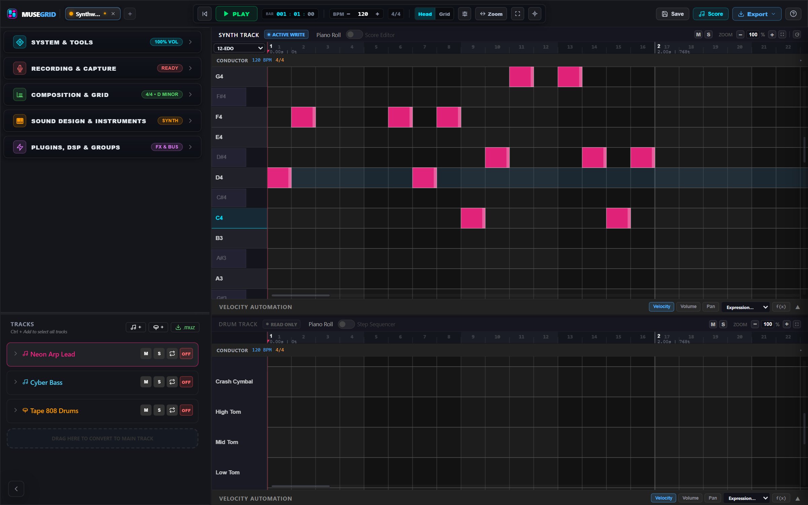
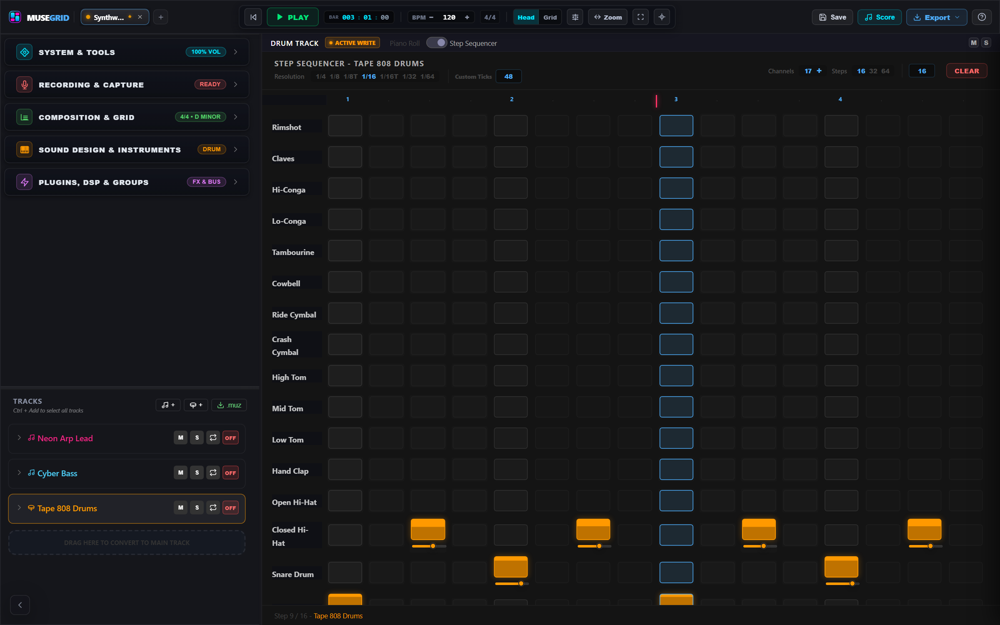
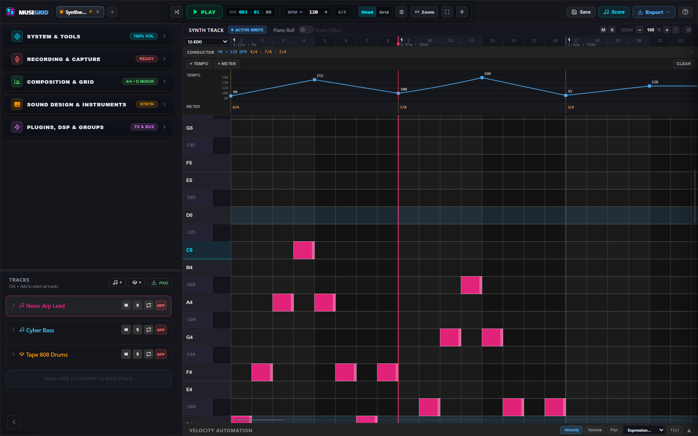
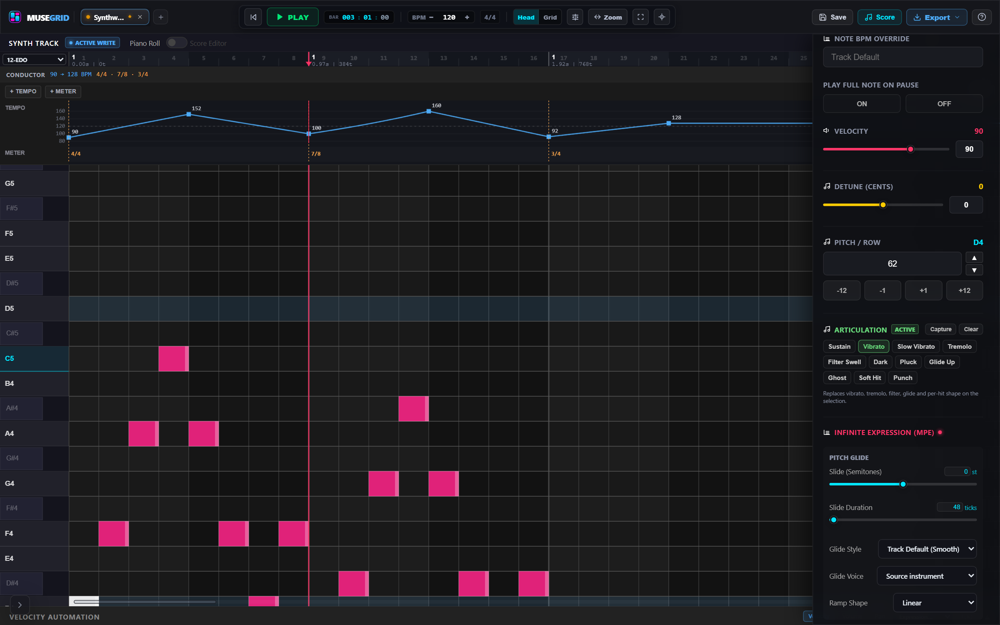
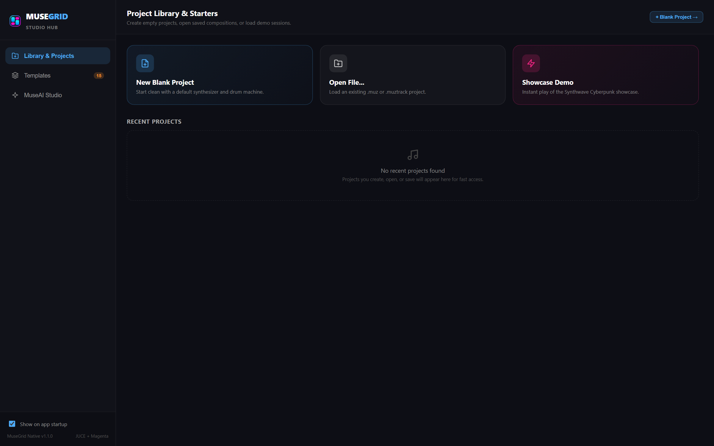

# MuseGrid

**A note-first sketchpad for musical ideas — not a DAW.**

MuseGrid is an offline composition workspace for Windows. It is built for the part of music-making that happens before the DAW: finding a riff, testing chords, programming a drum pattern, drawing a tempo curve, shaping articulation per note, and exporting the result as MIDI, audio, or notation.

Everything in MuseGrid is a note on one shared tick timeline. There are no audio clips to comp, no mixer sessions to manage, and no cloud account. Sketch the idea, then take it somewhere else to finish it.



## Why another music app

Most tools try to be the whole studio. MuseGrid deliberately stops at the note, because that is where ideas are still fluid.

- **Note-first, not clip-first.** Pitch, timing, velocity, expression, and articulation are editable at the individual note.
- **Offline and local.** Projects are plain JSON on disk, and the AI models are bundled to run locally. Nothing requires a connection.
- **Fast to a musical result.** Starters, generative sketches, scale lock, groove templates, and MIDI transforms exist to get a usable idea out quickly.
- **A companion, not a replacement.** Export MIDI, WAV/MP3, or MusicXML and finish in your DAW, or share a single track as `.muztrack`.

## A quick tour

### One workspace, two grids

The piano roll and the drum grid can share the screen, or each can take it over. Switch between **Split**, **Synth only**, **Drum only**, and **Active pane** layouts. Drum tracks swap the piano roll for a step sequencer with per-step velocity and per-channel controls, while synth tracks keep the full piano roll. Each step pad shows its velocity as a fill level; drag a lit pad up or down to change it.



The drum grid starts from a 16-channel template. It is a starting point, not a ceiling: add, rename, re-pitch, reorder, and remove channels as the kit requires.

### Tempo and meter that move

The conductor lane sits below the timeline and holds two independent maps:

- **Tempo map** with step, linear, exponential, and formula curves.
- **Meter map** with global time-signature changes.

Playback, the tick-to-seconds math, offline rendering, and MIDI export all follow the same conductor. A ritardando or a bar of 7/8 is therefore part of the file, not just the session.



### Articulation without keyswitches

Articulation in MuseGrid is a bundle of per-note expression values — vibrato, tremolo, filter sweep, pitch slide, glide style, octave spread, resonance, and decay. Apply a built-in preset, tweak the individual values, or capture the current selection as your own preset.



There is no sample-library keyswitch map to configure. The articulation is written into the notes and travels with them.

### Start from something

The start screen is a project library with recent projects, 16 templates, a MuseAI Studio entry point, and a playable showcase demo, so the app opens on a musical surface rather than an empty grid.



## What is inside

### Composition

- Piano roll with draw, erase, select, move, split, join, and mute tools.
- Step sequencer with configurable step count and resolution.
- 192 PPQ tick timeline shared by every track.
- Snap grid with triplet and dotted divisions; `Alt` bypasses snap for micro-timing.
- MIDI transforms: legato, strum, flam, glue, dice, chop, arpeggio, ratchet, harmonize, modal transpose, force-to-scale, chord inversion, horizontal/vertical flip, time stretch, and micro-nudge.
- Velocity tools: ramp, compress, normalize, fixed value, and humanize.
- Groove templates (MPC 60 swing, Dilla-style late snares, house shuffle) with timing and velocity strength, plus groove extraction.
- Scale lock and music-theory helpers: chord detection, scale degrees, genre progressions, and mode tables.
- Per-note MPE expression: pitch slide, vibrato, tremolo, filter sweep, glide style/voice, per-note pan, detune, and per-note instrument or FX overrides.
- Live MIDI recording with input quantization and a retrospective capture buffer.

### Sound

- Synth presets: warm, piano, electric piano, marimba, pluck, pad, bass, bell, bright, glass, physical, vocal, and scripted.
- Sampler mode with loop points (`off`, `sustain`, `release tail`), start/end trim, and release-tail rendering.
- Fourier waveform designer for custom periodic waveforms.
- Drum kits: classic, acoustic, tight, electro, 808, tabla, custom, and scripted.
- Per-pad choice of synthesized or sampled drum voice, with physical-modelling controls (pitch, decay, resonance, punch octaves).
- EDO and microtonal tuning support, including Scala `.scl` import and `.scl`/`.kbm` export.
- Native VST3 hosting in the Windows build.

### Effects and routing

- Built-in rack: EQ, distortion, chorus, phaser, delay, Reverb, and DPreverb (a distributed pre-reverb with a controllable tail).
- Per-track FX racks, track groups with group-level volume/mute/solo, master limiting, and per-note FX-chain overrides.
- Custom effect scripting in JavaScript, running either in an `AudioWorklet` in real time or in the offline renderer.

### AI and audio tools

- Magenta melody and drum continuation (`MusicRNN`) and groove/beat interpolation (`MusicVAE`), with a procedural fallback when a model cannot run.
- Offline Demucs stem separation using a bundled ONNX model.
- Audio-to-MIDI transcription from a loaded or recorded audio file.
- AI models live under `public/ai_models` and run locally.

### Export

- WAV or MP3 mixdown of the master, a selected track (stem), or a set of selected tracks.
- Multi-region batch export with per-region start/end ticks.
- Optional peak normalization, auto-fade, and metronome inclusion.
- Standard MIDI File (Type 1) with tempo and time-signature metadata.
- MusicXML export and a score editor/preview.
- `.muztrack` track sharing and `.muz` project files.
- Scala tuning export.

### Workflow

- Project tabs, autosave, crash recovery, and persisted preferences.
- Undo/redo across edits.
- Scripting console with Monaco, a run history, and a global `window.Muse` API.
- Built-in help pane with reference material.

## Run it

### Requirements

- **Node.js** `^20.19` or `>=22.12` (required by Vite 8).
- **Windows 10/11** for the native build.
- For the JUCE binary: Visual Studio Build Tools with the C++ workload, CMake, Ninja, and a `JUCE` checkout next to this repository (`../JUCE`).
- For the Inno Setup installer: Inno Setup 6 (`ISCC.exe`).

### Browser development

```bash
npm install
npm run dev:web
```

This runs the React UI in a browser with Vite HMR, using the Tone.js + Web Audio engine. The DSP worklet is built from AssemblyScript:

```bash
npm run build:wasm
```

### Electron development

```bash
npm install
npm run dev
```

`npm run dev` starts Vite with the Electron plugin, so the desktop shell and renderer reload together.

### Builds

| Command | Result |
| --- | --- |
| `npm run build:wasm` | Compiles `assembly/index.ts` to `public/audio-dsp.wasm` |
| `npm run build:electron` | WASM + typecheck + Vite build, then Electron Builder (NSIS installer and portable exe) |
| `npm run build:native:full` | WASM + web build + JUCE native binary, copied into `bin/` |
| `npm run build:native` | Rebuilds only the JUCE binary and syncs `dist/`, `public/`, and the icon into `bin/` |
| `npm run build` / `npm run build:setup` | Full Windows setup: WASM, web build, JUCE, then the Inno Setup installer |
| `npm run start:native` | Syncs assets and launches `bin\MuseGrid.exe` |

### Checks

```bash
npm run lint
node --test tests/audioPlayback.regression.test.ts
```

The regression suite uses Node's built-in test runner rather than Vitest.

## Architecture

MuseGrid has three audio paths that share one project model:

1. **Browser / Electron renderer** — React 19 + TypeScript + Zustand, with Tone.js scheduling and a Web Audio graph. The AssemblyScript WASM engine provides a sample-block synth/drum path and hosts custom effects on the audio thread.
2. **Native Windows build** — the same React UI hosted in a JUCE `WebBrowserComponent` (WebView2), with a C++ audio engine for low-latency synthesis, sampling, physical modelling, vocal modelling, recording, and VST3 hosting.
3. **Offline renderer** — the export path renders the project with the Tone.js engine, or with the native offline renderer where the request can be reproduced exactly. A project with an active tempo map stays on the tick-integrated Tone renderer because the native offline path bounces at one constant BPM.

Key directories:

```text
src/engine/          Zustand store, AudioEngine, Scheduler, recording, ScriptAPI
src/renderer/        Canvas piano roll, drum sequencer, conductor lane, score editor
src/ui/              Panes, inspectors, studios, modals, help
src/utils/           Conductor, articulations, theory, MIDI editing, export encoders
assembly/            AssemblyScript DSP compiled to WebAssembly
electron/            Electron main process and preload bridge
native/Source/       JUCE audio engine, bridge, and VST3 host
public/ai_models/    Bundled Magenta and Demucs models
scripts/             Windows native and installer build scripts
tests/               Node regression tests
```

Project data lives in JSON:

- `.muz` — the full session: tracks, notes, conductor maps, FX, mixer state, tuning.
- `.muztrack` — a shareable track: base BPM and time signature plus notes; optional per-note `expression`; format version 1.0.

## Scripting

The scripting console exposes `window.Muse` and `window.MuseState`. Anything the UI can do through the store is reachable from a script.

```js
// Create a track, add a four-note phrase, and start playback.
const trackId = Muse.track.add('Scripted Lead', 'synth')

const pitches = [60, 64, 67, 72]
pitches.forEach((pitch, i) => {
  Muse.editor.addNote({
    trackId,
    pitch,
    time: i * 192,       // 192 ticks = one quarter note
    duration: 180,
    velocity: 0.8,
  })
})

Muse.transport.setBpm(110)
Muse.transport.play()
```

Useful namespaces:

- `Muse.track` — add, remove, update, select, and inspect tracks.
- `Muse.editor` — notes, selection, and MIDI transforms.
- `Muse.transport` — play, pause, stop, seek, BPM, and time signature.
- `Muse.ui` — panes, modals, grid mode, zoom, and toasts.

## Keyboard shortcuts

| Key | Action |
| --- | --- |
| `Space` | Play / pause |
| `Ctrl+S` / `Ctrl+O` | Save / open project |
| `D` `E` `S` `M` `X` `J` `T` | Draw, erase, select, move, split, join, mute |
| `Delete` / `Backspace` | Delete selected notes |
| `Ctrl+Z` / `Ctrl+Y` | Undo / redo |
| `Ctrl+C` / `Ctrl+V` / `Ctrl+D` | Copy / paste / duplicate |
| `Ctrl+A` | Select all notes on the active track |
| `Arrow keys` | Pan the grid |
| `Shift` + wheel | Fast horizontal scroll |
| `Ctrl` + wheel | Horizontal zoom |
| `Alt` + drag | Bypass snap |

## Deliberate limits

These are product boundaries, not unfinished features:

- **No audio clips, comping, or waveform editing.** Audio enters through recording, stem splitting, and transcription; the composition surface stays note-based.
- **No lyrics-to-vocal generation.** There is a vocal-model instrument, but MuseGrid does not turn typed lyrics into a sung performance.
- **No live collaboration or cloud sync.** The app is offline and local-first.
- **MusicXML export currently writes one tempo and one time signature.** The conductor map is a project feature; the notation exporter does not encode tempo/meter changes yet.
- **`.muztrack` carries one base BPM and time signature.** The conductor map belongs to the `.muz` project. Per-note articulation travels in an optional `expression` object; multi-note glide chains do not, because imported notes receive new IDs.

## Documentation

- [`markdowns/features.md`](markdowns/features.md) — detailed feature and workflow reference.
- [`markdowns/audit.md`](markdowns/audit.md) — engineering audit, verification notes, and known constraints.

## License

No open-source license has been published for this repository.
