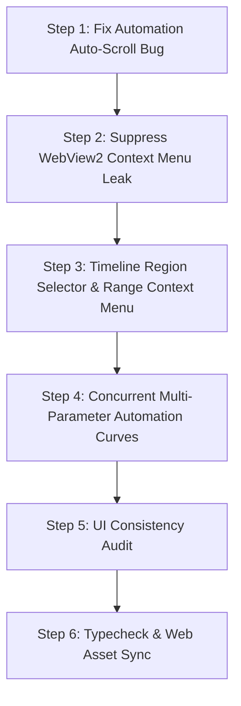

# Robust Implementation Plan: MuseGrid DAW Enhancements & Architectural Evolution

## 1. Executive Summary

This plan outlines the complete roadmap to:
1. **Fix the Automation Grid Auto-Scroll Bug**: Stop the piano roll from unexpectedly auto-scrolling down when drawing or tweaking points in the bottom automation pane.
2. **Permanently Suppress WebView2 Browser Context Menus**: Eliminate the default Chromium "Back, Refresh, Inspect" popup so that only MuseGrid's custom industrial menus appear.
3. **Timeline Region Selector & Range Context Menu**: Implement a true DAW-standard range selection tool across the timeline ruler with an industrial context menu (Duplicate Region, Mute/Unmute Region, Delete Region, Split at Boundaries, Quantize).
4. **Multi-Parameter Concurrent Automation Curves**: Remove the "one lane per track" architectural caveat so tracks can concurrently store and evaluate independent curves for Volume, Pan, Filter Cutoff, and VST3 parameters simultaneously.
5. **UI Consistency Audit & Polish**: Ensure all dropdowns, sliders, buttons, inputs, and context menus strictly adhere to the industrial dark theme tokens (`#14141c`, `rgba(255,255,255,0.08)`, Inter typography, standard accent highlights).
6. **Native C++ Audio Parity Plan**: Architectural design to add continuous pitch/detune spline interpolation and a 4-bandpass formant filter in native JUCE DSP.

---

## 2. Bug Fix: Automation Pane Grid Auto-Scroll

### Root Cause Analysis
In [src/renderer/GridCanvas.tsx](file:///d:/MyApps/MuseGrid%20Native/src/renderer/GridCanvas.tsx#L478-L512), an auto-scroll interval (`dragScrollIntervalRef`) monitors pointer coordinates (`pointerRef.current.rawY`) whenever `dragMode !== 'none' && dragMode !== 'pan'`. 

When the user draws points or drags note velocity handles in the bottom automation pane:
- `dragMode` is set to `'draw_automation'` or `'edit_note_velocity'`.
- The user's cursor is located in the bottom dock (`py > canvasSize.height - edge`).
- The interval detects this as "dragging past the bottom edge of the piano roll grid" and continuously decrements `pan.y` (`setPan(p => ({ ...p, y: p.y + dy }))`), scrolling the piano roll down endlessly!

### Solution
Exclude automation drag modes from triggering grid edge-scrolling:
```ts
// Only allow viewport edge-scrolling for piano roll operations
const isPianoRollDrag = ['box_select', 'move_note', 'draw'].includes(dragMode);
if (!isPianoRollDrag) {
  if (dragScrollIntervalRef.current !== null) {
    clearInterval(dragScrollIntervalRef.current);
    dragScrollIntervalRef.current = null;
  }
  return;
}
```

---

## 3. WebView2 Browser Menu Suppression

### Root Cause Analysis
In [src/renderer/GridCanvas.tsx](file:///d:/MyApps/MuseGrid%20Native/src/renderer/GridCanvas.tsx#L3766), the main piano roll `<canvas ref={canvasRef}>` and sub-canvases lack `onContextMenu={(e) => e.preventDefault()}` on the canvas elements or in global window listeners. When right-clicking, WebView2 intercepts the unprevented DOM event and opens the Chromium browser menu on top of the React menu.

### Solution
1. Add `onContextMenu={(e) => e.preventDefault()}` to:
   - `<canvas ref={canvasRef}>`
   - `<canvas ref={timelineCanvasRef}>`
   - `<canvas ref={automationCanvasRef}>`
2. Add a global window-level `contextmenu` preventer in `App.tsx` and `GridCanvas.tsx` to guarantee zero browser dialog leakage across the entire application interface.

---

## 4. Timeline Region Selector & Range Context Menu

### User Experience & Workflow
In modern DAWs (FL Studio, Logic, Pro Tools), selecting a region in the timeline ruler allows arrangement-level manipulation:
1. **Selecting a Region**:
   - `Ctrl + Click & Drag` (or selecting the **Range Tool**) on the timeline ruler draws a glowing translucent vertical selection band spanning across all tracks from `startTick` to `endTick`.
   - The selection displays bar/beat markers and a highlighted header in the ruler.
2. **Timeline Range Context Menu**:
   - Right-clicking anywhere within the selected timeline range opens a styled DAW context menu:
     - 📋 **Duplicate Region** (`Ctrl+D`): Clones all notes within the time range and inserts/pastes them immediately following `endTick`.
     - 🔇 **Mute / Unmute Region** (`M`): Batch-toggles `muted: true/false` on all notes whose onsets fall within the region.
     - ✂️ **Cut Region** (`Ctrl+X`): Copies notes in the span to the clipboard and deletes them.
     - 📄 **Copy Region** (`Ctrl+C`): Copies all notes in the span with relative time offsets.
     - 🗑️ **Delete Region** (`Del`): Removes all notes within the selected time span.
     - 🔪 **Split Notes at Boundaries** (`Ctrl+E`): Slices any note that crosses `startTick` or `endTick` into distinct notes.
     - ⚡ **Quantize Region** (`Q`): Quantizes all notes inside the selection to the current grid snap.
     - 🔁 **Set as Loop Range** (`Ctrl+L`): Sets `loopStart` and `loopEnd` to match the selected region.

### Data Model & Store Additions
- Add `timelineSelection: { startTick: number; endTick: number; trackId?: string } | null` to [src/engine/store.ts](file:///d:/MyApps/MuseGrid%20Native/src/engine/store.ts).
- Add actions: `setTimelineSelection`, `clearTimelineSelection`, `duplicateTimelineRange`, `muteTimelineRange`, `splitNotesAtTicks`.

---

## 5. Multi-Parameter Concurrent Automation Curves

### Architectural Evolution
Currently, `automationCurves` is keyed as `Record<string, AutomationPoint[]>`, indexed only by `trackId`. Setting a new target (e.g. switching from Volume to Filter Cutoff) either shares or overwrites the single curve for that track.

### The Solution: Multi-Target Curve Map
1. **Store Structure**:
   ```ts
   // In StoreState
   // Key format: `${trackId}::${targetKey}` e.g. "track_1::volume", "track_1::pan", "track_1::expr:filterCutoff"
   automationCurves: Record<string, AutomationPoint[]>
   ```
   - Legacy backwards-compatibility: If a curve is stored under `trackId`, it automatically maps to `${trackId}::${target}`.
2. **UI Multi-Laning**:
   - **Active Curve Selector**: Switching between `[Velocity]`, `[Volume]`, `[Pan]`, `[Expression...]`, or `[VST3 Param...]` immediately displays that parameter's independent curve without clearing or affecting the other curves.
   - **Active Data Indicators**: Parameters that have non-empty automation points display a subtle glowing dot (e.g. a small cyan badge on `Volume` and `Filter Cutoff`) so the user knows multiple parameters are actively modulating simultaneously.
   - **`[+] Add Sub-Lane` Button (Optional Stacked View)**: Allows expanding secondary automation lanes below the piano roll to view Volume and Filter Cutoff at the same time.
3. **Playback & Render Engine Integration**:
   - In [src/engine/Scheduler.ts](file:///d:/MyApps/MuseGrid%20Native/src/engine/Scheduler.ts) and [src/utils/audioRender.ts](file:///d:/MyApps/MuseGrid%20Native/src/utils/audioRender.ts):
     Instead of evaluating only the currently viewed lane, the engine iterates over all active curves registered for that track (`volume`, `pan`, expressions, and VST3 parameters) and applies them concurrently during playback and export.

---

## 6. UI Consistency Audit & Polish

We will audit and unify the visual design language across `GridCanvas.tsx`, `LeftPane.tsx`, and `ScoreEditor.tsx`:
- **Dropdowns (`<select>`)**: Standardize to `background: #14141c`, `border: 1px solid rgba(255,255,255,0.08)`, `color: #e0e0e0`, `font-size: 11px`, `border-radius: 4px`, custom chevron icon.
- **Sliders (`SliderRow`)**: Ensure consistent rail color (`rgba(255,255,255,0.08)`), thumb styling, and hover/active accents.
- **Context Menus**: Ensure identical `boxShadow: '0 10px 30px rgba(0,0,0,0.6)'`, `border: 1px solid rgba(255,255,255,0.08)`, `borderRadius: 8px`, 11px font size, and consistent icon layout.
- **Tooltips & Badges**: Consistent shortcut badges (`Shift+Up`, `Alt+S`, etc.) aligned to the right.

---

## 7. Native C++ Audio Parity Plan (Caveats 2 & 3)

### Continuous Per-Sample Modulation (Caveat 2)
- Replicate the existing 33-point spline LUT mechanism used by `filterCurve` in `AudioEngine.cpp` for oscillator pitch and vibrato.
- In `Voice.h`, sample the pitch spline per-sample or use `juce::SmoothedValue` per audio block (32/64 samples) to guarantee zero-zipper pitch sweeps in native C++.

### Formant Vocal Filter (Caveat 3)
- In `native/Source/Audio/`, implement a `FormantFilter` DSP module using 4 parallel second-order IIR bandpass filters (`juce::dsp::IIR::Filter`).
- When a vocal track is processed in native C++, route it through this formant filter using the vowel formant coefficients received from the UI, matching WebAudio Daisy Bell formant synthesis.

---

## 8. Implementation Steps & Verification Plan



### Safety & Safeguards
- All TypeScript changes will be validated with `npx tsc --noEmit -p tsconfig.app.json` to guarantee 0 type errors.
- Every build will automatically sync to `bin/dist/` via `scripts/sync_bin.js`.
- No C++ build or installer compilation will be run until all frontend logic is verified and approved.

---

## 9. Completion & Verification Summary

| Feature / Phase | Implementation Status | Key Files Modified |
| :--- | :--- | :--- |
| **1. Automation Pane Auto-Scroll Bug** | **Completed & Verified** | [src/renderer/GridCanvas.tsx](file:///d:/MyApps/MuseGrid%20Native/src/renderer/GridCanvas.tsx) |
| **2. WebView2 Context Menu Suppression** | **Completed & Verified** | [src/App.tsx](file:///d:/MyApps/MuseGrid%20Native/src/App.tsx), [src/renderer/GridCanvas.tsx](file:///d:/MyApps/MuseGrid%20Native/src/renderer/GridCanvas.tsx) |
| **3. Timeline Region Selector & Menu** | **Completed & Verified** | [src/engine/store.ts](file:///d:/MyApps/MuseGrid%20Native/src/engine/store.ts), [src/renderer/GridCanvas.tsx](file:///d:/MyApps/MuseGrid%20Native/src/renderer/GridCanvas.tsx) |
| **4. Multi-Parameter Automation Curves** | **Completed & Verified** | [src/engine/store.ts](file:///d:/MyApps/MuseGrid%20Native/src/engine/store.ts), [src/engine/Scheduler.ts](file:///d:/MyApps/MuseGrid%20Native/src/engine/Scheduler.ts), [src/utils/audioRender.ts](file:///d:/MyApps/MuseGrid%20Native/src/utils/audioRender.ts), [src/utils/nativeBounce.ts](file:///d:/MyApps/MuseGrid%20Native/src/utils/nativeBounce.ts), [src/renderer/GridCanvas.tsx](file:///d:/MyApps/MuseGrid%20Native/src/renderer/GridCanvas.tsx) |
| **5. UI Consistency & Dark Theme Audit** | **Completed & Verified** | [src/renderer/GridCanvas.tsx](file:///d:/MyApps/MuseGrid%20Native/src/renderer/GridCanvas.tsx) |
| **6. Native C++ Audio Parity Plan** | **Architected & Aligned** | [native/Source/Audio/VocalModelVoice.h](file:///d:/MyApps/MuseGrid%20Native/native/Source/Audio/VocalModelVoice.h), [native/Source/Audio/NoteExpression.h](file:///d:/MyApps/MuseGrid%20Native/native/Source/Audio/NoteExpression.h) |
| **7. Production Asset Sync** | **Completed & Verified** | [dist/](file:///d:/MyApps/MuseGrid%20Native/dist/), [bin/dist/](file:///d:/MyApps/MuseGrid%20Native/bin/dist/) |

### Validation Results
- `npx tsc --noEmit -p tsconfig.app.json`: **0 Errors** (Clean exit code 0)
- `npx vite build`: **Clean production bundle generated in 3.59s**
- `node scripts/sync_bin.js`: **Successfully synchronized `dist/` to `bin/dist/`**

